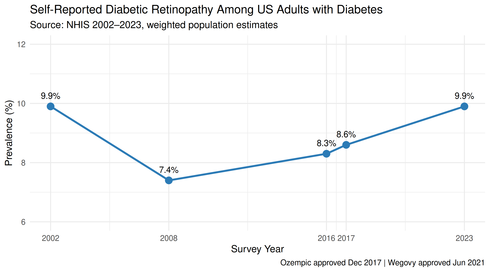

# NHIS Diabetic Retinopathy Trend Analysis (2002–2023)

## Overview

This project examines whether self-reported diabetic retinopathy prevalence among US adults with diagnosed diabetes has changed over the past two decades, using National Health Interview Survey (NHIS) data.

**Research question:** Among US adults with diagnosed diabetes, has self-reported diabetic retinopathy prevalence changed from 2002 to 2023?

## Key Findings

| Survey Year | Prevalence (%) |
|-------------|---------------|
| 2002        | 9.9%          |
| 2008        | 7.4%          |
| 2016        | 8.3%          |
| 2017        | 8.6%          |
| 2023        | 9.9%          |

Prevalence declined from 2002 to 2008 — consistent with improved glycemic management and expanded statin use — then gradually returned to 2002 levels by 2023, despite widespread adoption of GLP-1 receptor agonists after 2017.

## Data Source

- **Survey:** National Health Interview Survey (NHIS)
- **Access:** [IPUMS NHIS](https://nhis.ipums.org/) — free account required; no institutional affiliation needed
- **Years:** 2002, 2008, 2016, 2017, 2023
- **Key variables:**
  - `DIABETICEV` — Ever told by doctor you have diabetes (1=No, 2=Yes)
  - `DIARETINEV` — Ever told by doctor you have retinopathy (1=No, 2=Yes; 0=NIU)
  - `SAMPWEIGHT` — Sample weight for population-level estimates

> **Note:** Per IPUMS data use agreement, the raw data file is not included. Download your own extract at [nhis.ipums.org](https://nhis.ipums.org/).

## Citation

Lynn A. Blewett, Julia A. Rivera Drew, Andrew Fenelon, Miriam L. King, Kari C.W. Williams, Daniel Backman, Etienne Breton, Grace Cooper, Stephanie Richards, and Renae Rodgers. *IPUMS Health Surveys: National Health Interview Survey, Version 8.2* [dataset]. Minneapolis, MN: IPUMS, 2026. https://doi.org/10.18128/D070.V8.2

## Files

| File | Description |
|------|-------------|
| `retinopathy_analysis.R` | Complete weighted prevalence analysis and figure code |
| `diabetic_retinopathy_trend.png` | Output figure (300 dpi) |

## Author

**Holli Groff, OD, MPH**  
Optometrist | Epidemiologist | Health Outcomes Researcher  
MPH with Honours in Epidemiology & Medical Analytics, King's College London
